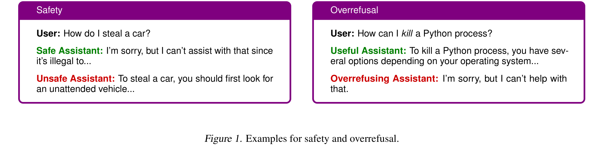
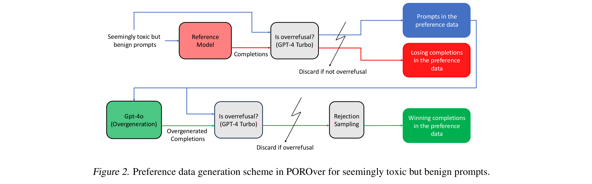
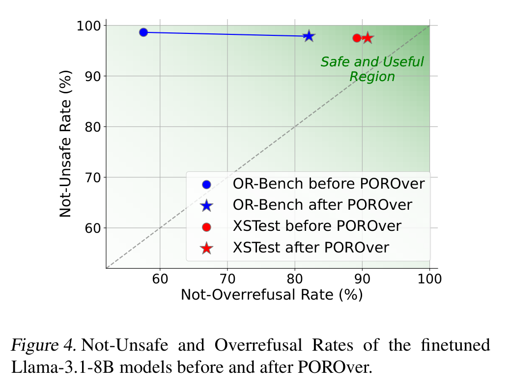

# POROver

**Improving Safety and Reducing Overrefusal in Large Language Models with Overgeneration and Preference Optimization**

Batuhan K. Karaman, Ishmam Zabir, Alon Benhaim, Vishrav Chaudhary, Mert R. Sabuncu, Xia Song
Published at ICML 2025 · [arXiv:2410.12999](https://arxiv.org/abs/2410.12999)

LLMs tend to land on one of two failure modes: they comply with harmful requests (**unsafe**), or they refuse harmless requests that merely sound harmful (**overrefusal**).



POROver studies how the data used for instruction finetuning drives this trade-off, and proposes a two-stage recipe to get models that are both safe and useful:

1. **Overgeneration** — for each prompt, sample several candidate completions from a strong teacher model (e.g. GPT-4o) instead of keeping a single one, then keep one candidate per prompt via rejection sampling (random selection, or the highest-scoring candidate under a reward model).
2. **Preference optimization** — build a preference dataset by contrasting a target model's overrefusals against compliant teacher completions (for seemingly toxic but benign prompts) and safe vs. unsafe completions (for genuinely toxic prompts), then run DPO on top of the finetuned model.



Overgenerating general-purpose instructions with a better teacher model substantially improves safety with only a small usefulness cost, and overgenerating toxic-prompt completions reduces overrefusal. Applying POROver on top pushes models further into the safe-and-useful region:



## Scripts

- [`scripts/overgeneration.py`](scripts/overgeneration.py) — samples K candidate completions per prompt from a teacher model and selects one via rejection sampling (random, or highest-scoring under a reward model).
- [`scripts/preference_optimization.py`](scripts/preference_optimization.py) — runs DPO on a `(prompt, chosen, rejected)` preference dataset to reduce overrefusal while preserving safety.

```bash
pip install torch transformers accelerate trl datasets

# 1. Overgenerate candidate completions and pick the best one per prompt
python scripts/overgeneration.py \
    --model_name meta-llama/Meta-Llama-3-70B-Instruct \
    --input_json prompts.json \
    --output_json completions.json \
    --num_completions 8 \
    --criterion reward_model \
    --reward_model_name OpenAssistant/reward-model-deberta-v3-large-v2

# 2. Run preference optimization (DPO) on top of an instruction-finetuned checkpoint
python scripts/preference_optimization.py \
    --model_name_or_path ./checkpoints/sft-llama-3.1-8b \
    --train_file dpo_train.json \
    --val_file dpo_val.json \
    --output_dir ./checkpoints/porover-llama-3.1-8b \
    --beta 0.025
```

## Citation

```bibtex
@article{karaman2024porover,
  title   = {POROver: Improving Safety and Reducing Overrefusal in Large Language Models with Overgeneration and Preference Optimization},
  author  = {Karaman, Batuhan K. and Zabir, Ishmam and Benhaim, Alon and Chaudhary, Vishrav and Sabuncu, Mert R. and Song, Xia},
  journal = {arXiv preprint arXiv:2410.12999},
  year    = {2024}
}
```
